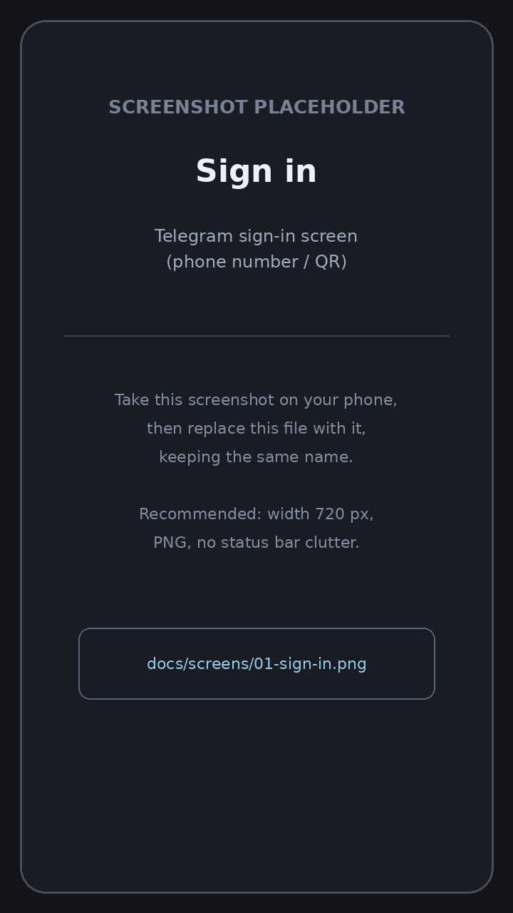
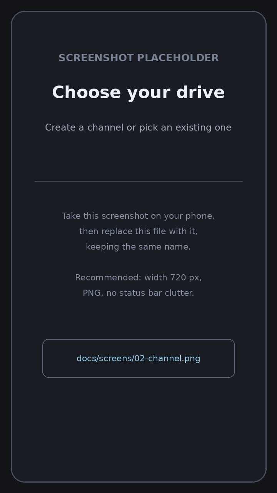
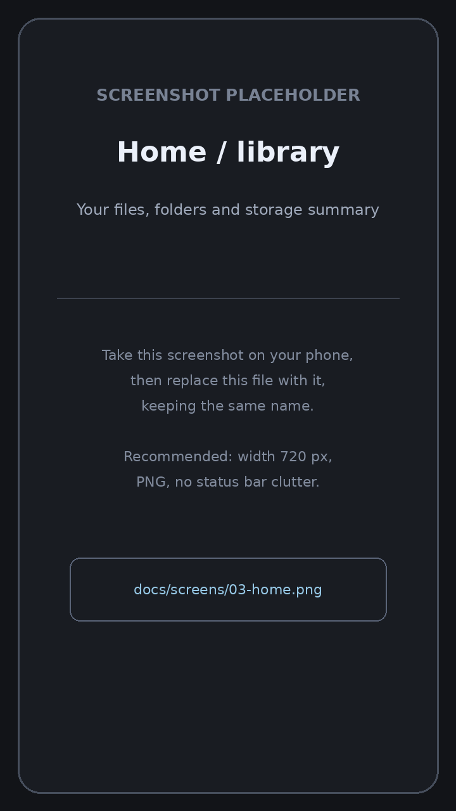
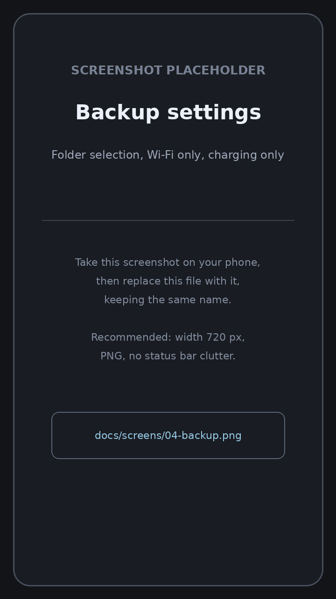
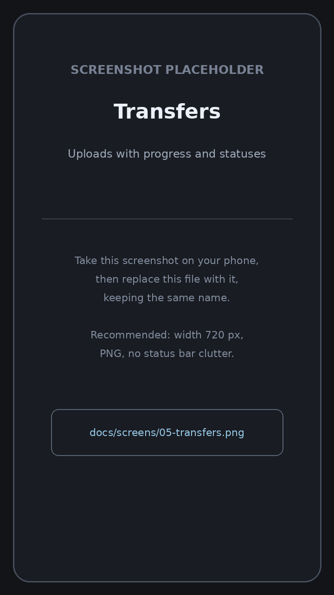
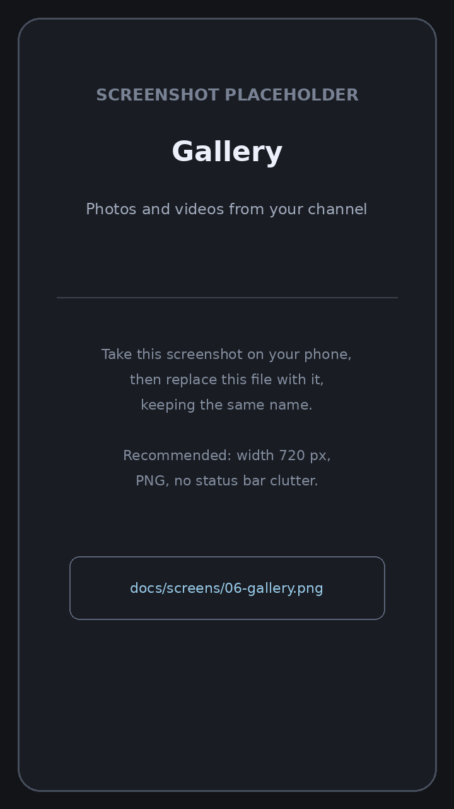
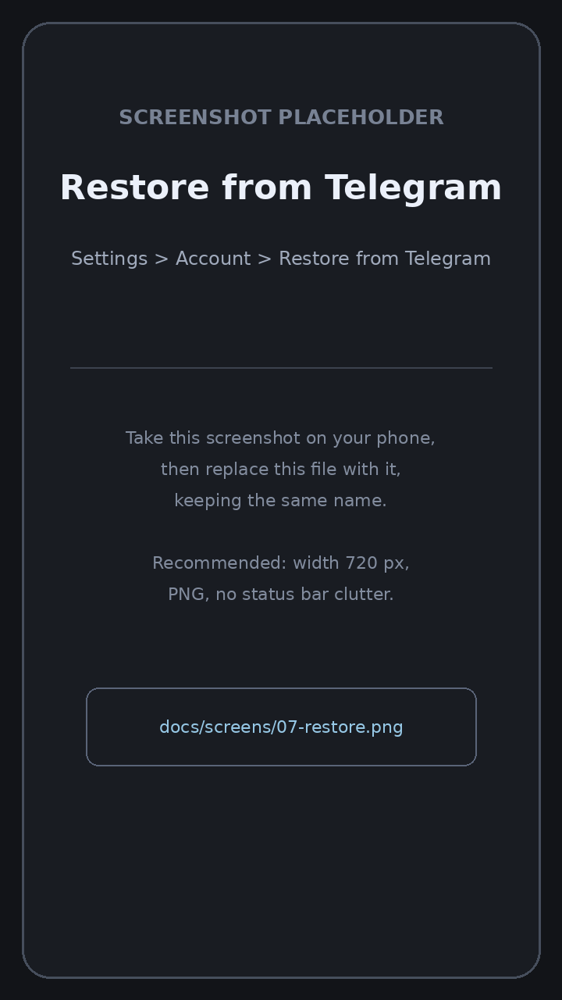
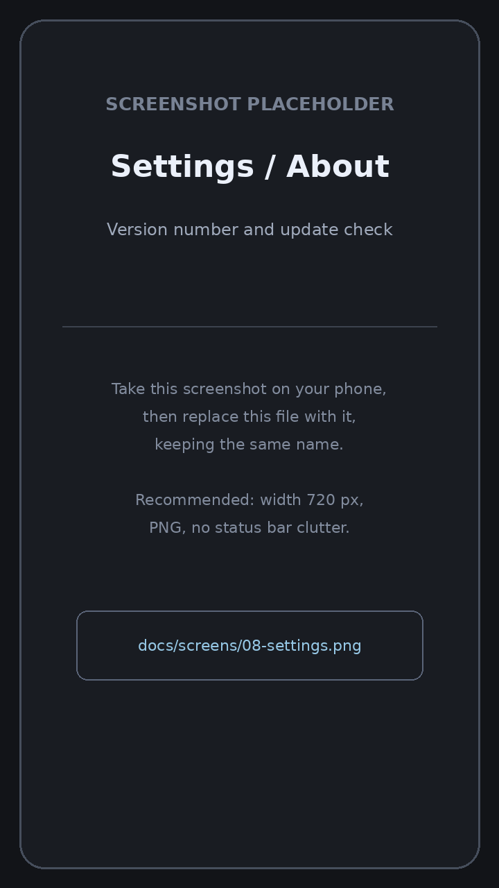

# Memora Cloud

**Back up your phone's files into your own private Telegram channel.** No subscription, no server of
ours, no cloud account to rent — the storage is the Telegram account you already have.

Your photos, videos, documents and audio are uploaded to a channel only you can open. The app keeps
an index of everything, so you get a real file manager on top of it: browse, search, restore, share.
If you lose the phone, sign in on a new one and your library rebuilds itself from Telegram.

* **Free forever** — you already own the storage.
* **No account with us** — nothing to register, nothing to pay.
* **Nothing leaves your account** — backup traffic goes from your phone to your own channel.
* **Works offline-first** — the index is on the phone, so browsing is instant.

---

## Screenshots

<table>
  <tr>
    <td align="center"> <b>1. Sign in</b></td>
    <td align="center"> <b>2. Pick your channel</b></td>
    <td align="center"> <b>3. Your library</b></td>
    <td align="center"> <b>4. Backup rules</b></td>
  </tr>
  <tr>
    <td align="center"> <b>5. Transfers</b></td>
    <td align="center"> <b>6. Gallery</b></td>
    <td align="center"> <b>7. Restore</b></td>
    <td align="center"> <b>8. Settings</b></td>
  </tr>
</table>

> The images above are placeholders until the real screens are captured — see
> [`docs/screens/README.md`](docs/screens/README.md) for the exact shots to take.

---

## Install

1. Open the [**Releases**](../../releases) page and download the APK for your phone.
   * `arm64-v8a` — almost every phone from the last several years. **Pick this one if unsure.**
   * `armeabi-v7a` — older 32-bit devices.
   * `x86_64` — emulators and a few tablets.
   * `universal` — works anywhere, but much larger.
2. Tap the downloaded file. Android will ask to allow installs from your browser or file manager —
   allow it once.
3. Play Protect may warn that the app is unknown. That is normal for any app installed outside the
   Play Store; choose **Install anyway**.

Verify the download if you want: every release includes `SHA256SUMS.txt`.

**Requirements:** Android 8.0 (Oreo) or newer.

---

## First run — five minutes

**1. Sign in with Telegram.** Enter the `api_id` and `api_hash` the app asks for (it links you to
`my.telegram.org` where you create them in a minute), then your phone number and the login code
Telegram sends. Two-step verification, if you use it, is asked too.

Nothing is sent to us — the credentials stay on the phone.

**2. Choose your drive.** The app needs one private channel to store files in. You can:

* **create a new one** — the easiest path, the app makes it and keeps it private;
* **use an existing one** — any channel you own, including one already full of backups;
* **switch drives later** — Settings → Account.

If the channel already holds a backup from an earlier install, the app offers to rebuild the index
from it.

**3. Grant permissions.** Photos and videos, so the backup can read your media; notifications, so
you see progress. Nothing else.

**4. Pick what to back up.** Settings → Backup → *Folders*. Choose whole folders or let it follow
the camera roll. Set the rules you want: **Wi-Fi only**, **charging only**, mobile data allowed or
not.

**5. Start it.** New photos are picked up automatically. For the existing library, open
**Transfers** and start the backup — it works through everything in the background, resuming after
interruptions and retrying failures on its own.

> Keep the app's battery optimisation off (Settings → Apps → Memora Cloud → Battery → Unrestricted).
> Aggressive battery savers kill long uploads.

---

## Backing up

* **Duplicates are recognised by content, not file name** — a renamed or copied photo is not
  uploaded twice. The SHA-256 hash lives both in the phone's index and in the channel itself.
* **Large files:** Telegram allows **2 GB per file** (4 GB with Telegram Premium). Files larger than
  that cannot be uploaded — exclude those folders.
* **A batch takes time.** Telegram deliberately slows bulk uploads; a big library can run for hours.
  Wi-Fi plus charger is the sane way.
* **Watch the first few** in Transfers to confirm they reach *uploaded*, then leave it.

## Restoring files

Settings → Account → **Restore from Telegram**.

Pick a scope — everything, photos and videos, documents, or audio — and the screen tells you how
many files that is and how much of it is **not on this device** right now. *Skip files already on
this device* is on by default, so a restore never duplicates what you still have.

Restored files land in **Downloads/MemoraCloud** and can be opened from any file manager.

## New phone, or after reinstalling

Nothing is lost: the files live in your channel, not in the app.

1. Install, sign in with the same Telegram account.
2. Choose the channel that already holds your backup.
3. Settings → Account → **Rebuild index** — the library reappears.
4. Restore whatever you need to the device.

Your encryption key, if you turned encryption on, is restored separately — keep the key backup file
you were shown when you enabled it.

---

## Where your data lives

| Data | Location | Survives uninstall? |
| --- | --- | --- |
| Your files and photos | The Telegram channel you chose | **Yes** |
| Copies on the device | `Downloads/MemoraCloud` | **Yes** |
| File index, thumbnails, transfer queue | App-private storage | No — rebuilt from the channel |
| Telegram session, settings | App-private storage | No — sign in again |

**Deleting a file in the app moves it to Trash; it only disappears from Telegram when you empty
Trash.** That is the only action that destroys a backup copy.

The app has no analytics, no tracking, and no server of its own. The only network requests are to
Telegram (your account) and GitHub (update check).

---

## Troubleshooting

**The app closes immediately on opening.**
Open a file manager, go to `Downloads/MemoraCloud`, and read `memora-crash.txt`. The first
`Caused by:` line names the cause — send that with a bug report and it can be fixed quickly.

**The library is empty but the channel has files.**
Settings → Account → **Rebuild index**.

**The updater says an update check failed.**
GitHub limits anonymous checks per network address. The app reads the release page first, which has
no such limit; if it still fails, wait an hour or download the APK from the Releases page directly.

**Uploads stop when the screen is off.**
Battery optimisation is killing the app. Set it to *Unrestricted* and allow background data.

**A file refuses to back up.**
Check its size — over 2 GB (or 4 GB without Premium) it cannot be uploaded.

**Restore says 0 files.**
The chosen scope is already fully on the device. Turn *Skip files already on this device* off to
copy anyway.

---

## Building it yourself

The app is Android-only and builds with Gradle. A phone-friendly guide, including the GitHub Actions
route that needs no computer, is in [`SETUP.md`](SETUP.md). Releases are signed; the procedure and
the required secrets are in [`docs/SIGNING_AND_RELEASES.md`](docs/SIGNING_AND_RELEASES.md).

Feature-by-feature state, including what is deliberately unfinished, is in
[`docs/FEATURE_STATUS.md`](docs/FEATURE_STATUS.md).

---

## License

Memora Cloud is distributed under the **Apache License 2.0** — see [`LICENSE`](LICENSE).

It is built on open-source components, and it contains code derived from an earlier open-source
project; the attribution notices those licenses require are collected in [`NOTICE`](NOTICE).
Those notices are a legal requirement and cannot be removed, but they are kept to that file alone.
